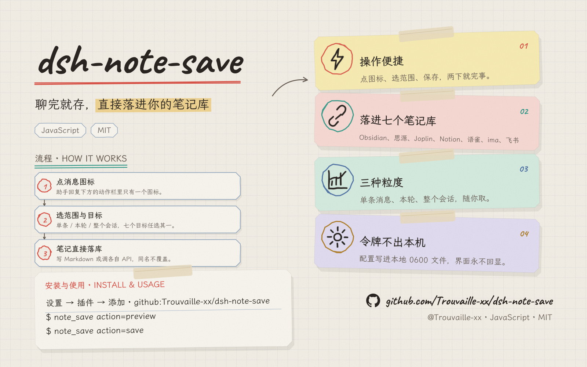
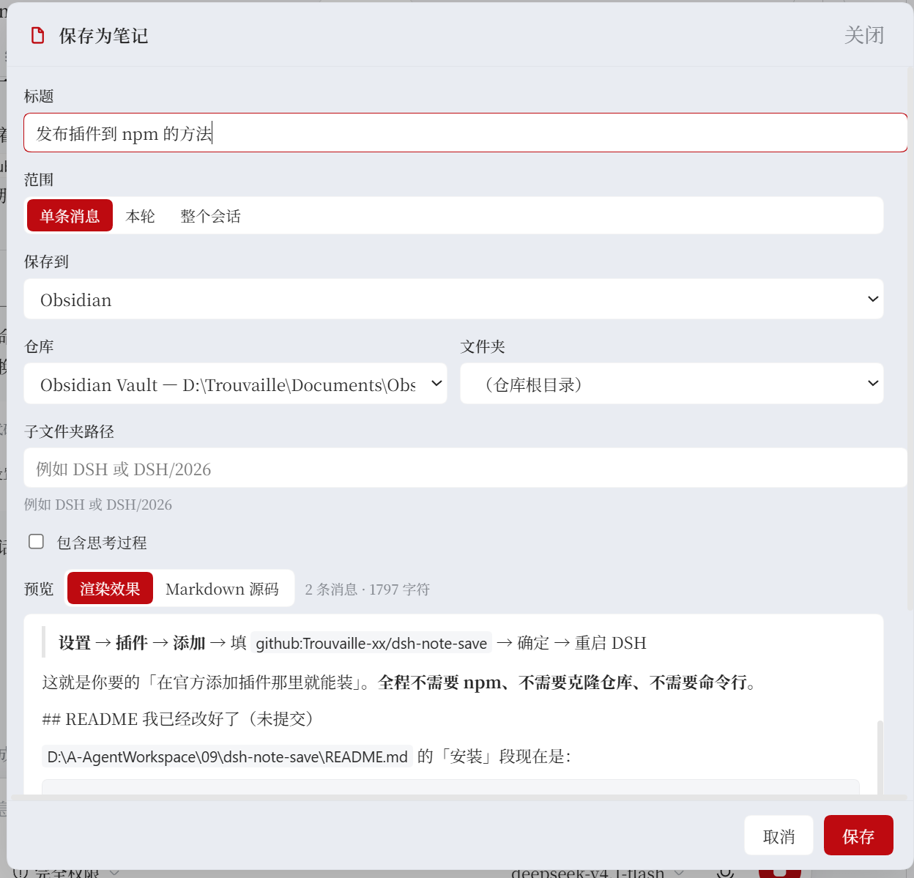
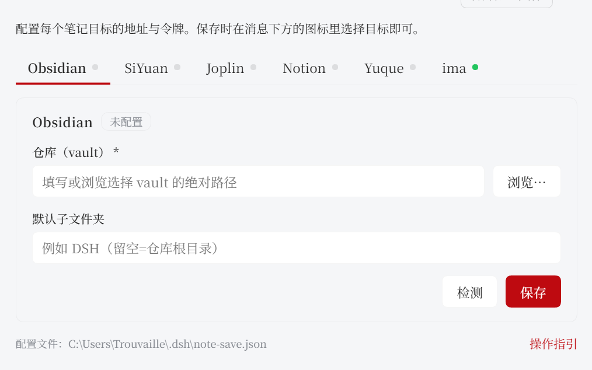

<p align="center">
  
</p>

# dsh-note-save

把 DSH 里的一段对话**保存成笔记**，写进你已经在用的笔记系统。只做保存（创建），不做笔记编辑。

一条助手消息下方的图标 → 一个面板 → 七个目标：

| 目标 | 写入方式 |
| --- | --- |
| **Obsidian** | 直接写 vault 里的 `.md` 文件 |
| **思源 SiYuan** | `createDocWithMd`（原生吃 Markdown） |
| **Joplin** | Web Clipper API（41184） |
| **Notion** | 挂到 Database 下，正文转 blocks |
| **语雀** | 建文档 + 追加目录（两步） |
| **ima** | 官方 OpenAPI `note/v1/import_doc`（Client ID + API Key） |
| **飞书** | 自建应用上传 Markdown → 导入任务转 docx（App ID + App Secret） |

## 它解决什么

DSH 自带的导出只会下载整段会话日志的 ZIP；社区里每个笔记目标各有一个插件，但每个插件自带一套配置、一套交互、一套格式损失。换一个笔记系统，就要重装一个插件。

这个插件把「保存」抽象成一层：**任何一段对话 → 一份 Markdown → 交给目标适配器**。所以七个目标用同一个面板、同一套粒度、同一种预览；新增目标只需要写一个 adapter 文件（见 `SPEC.md`）。

## 保存粒度

| 粒度 | 实际内容 |
| --- | --- |
| 单条消息 | 那条回答 + 它对应的提问（点消息图标的默认值） |
| 本轮 | 同一个 turn 的全部消息 |
| 整个会话 | 会话里所有用户/助手消息正文 |

工具输出、思考过程默认不进正文；思考过程可以按次勾选包含。

## 界面

**消息动作栏**：一个图标（只有图标，没有文字），`aria-label` 是「保存为笔记」，hover 有提示。点开是面板：

- 标题（自动生成，可改）
- 范围：单条消息 / 本轮 / 整个会话
- 目标：七个里选，未配置的置灰并直接写出缺什么
- 位置：Obsidian 是**选 vault + 选文件夹**（也可以手打更深的路径）；其他目标是各自的位置下拉
- 包含思考过程
- 预览：**渲染效果** / **Markdown 源码** 两种视图切换，带条数与字符数
- 取消 / 保存；保存中会锁住，防止重复写入



**设置 → 笔记保存**：顶部一排 Tab（Obsidian / 思源 / Joplin / Notion / 语雀 / ima，每个带一个「已配置」绿点），点哪个 Tab，下面就是那个目标的配置表单，表单底部有「检测」和「保存」。



表单里**只有字段**，没有解释性文字——「token 去哪拿」「写入会发生什么」这些统一放在页面底部的**「操作指引」**链接里（新标签页打开，是插件自己提供的 `/note-save/guide` 页面，自带深浅色、无外部依赖）。

文件夹类字段（目前只有 Obsidian 的 vault）是**可自由输入的文本框 + 「浏览…」按钮**：点按钮调 Host 原生目录选择器，也可以直接手打任意路径——vault 可以在任何位置，固定下拉表达不了这件事。

字段由后端 `/schema` 驱动，所以加目标不用改前端。「检测」用**你还没保存的值**去探测，可以先试再存。令牌字段永远不回显：存过就显示「已保存（留空表示不修改）」，勾「清除」才会删。配置文件路径放在页面底部。

## 安装

在 DSH 里打开 **设置 → 插件 → 添加**，填这一行：

```
github:Trouvaille-xx/dsh-note-save
```

不需要克隆仓库，不需要 npm。也可以让 agent 代劳：

```
plugin_manager action=install_bundle target="github:Trouvaille-xx/dsh-note-save"
```

装完**重启一次 DSH**。卸载走同一个入口。

> 想锁定版本就带 tag：`github:Trouvaille-xx/dsh-note-save#v0.1.0`（或 `#<commit-sha>`）。不带 tag 时每次重装都拉 `main` 的最新提交。

> 改完插件代码后如果只看到新界面、接口却报「未知接口」，说明前端热更新了而宿主没有——把插件行停用再启用一次，或重启 DSH。

## 开发

```
node tests-lead/all.test.mjs     # 全部 8 个套件，160 条
```

不要用 `node --test`：它会 fork 子进程，在 DSH 的沙箱里会以 `spawn EPERM` 失败；直接 `node <file>` 是单进程跑的同一批断言。

## 配置

设置页写的就是这个文件：`%USERPROFILE%\.dsh\note-save.json`（设了 `DSH_HOME` 就是 `$DSH_HOME/note-save.json`），首次保存时按默认值创建，权限 0600。

**不放 profile 的 `cordis.patch.yml`**：那是用户的文件、常被同步、常手改，token 不该进去。

```jsonc
{
  "version": 1,
  "defaultTarget": "obsidian",
  "targets": {
    "obsidian": { "vault": "D:\\文档\\obsidian\\workspace", "subdir": "", "frontmatter": true },
    "siyuan":   { "baseUrl": "http://127.0.0.1:6806", "token": "", "notebook": "" },
    "joplin":   { "baseUrl": "http://127.0.0.1:41184", "token": "", "folder": "" },
    "notion":   { "token": "", "databaseId": "", "titleProperty": "Name" },
    "yuque":    { "token": "", "repoId": "", "login": "", "repoSlug": "" },
    "ima":      { "clientId": "", "apiKey": "", "notebook": "" },
    "feishu":   { "appId": "", "appSecret": "", "folderToken": "" }
  }
}
```

Obsidian 的 `vault` 留空时会回落到 Obsidian 自己登记的 vault；但正常路径是**你在设置页或面板里选**，不是预设。

## ima：有官方 OpenAPI，直接建笔记

先说一个**已修正的错误**：这个插件最早把 ima 当成「没有接口，只能投递文件」。那是错的——ima **有**官方 OpenAPI，笔记是直接创建进 ima 的，不是写文件夹。

用的是腾讯自己的 `TencentCloud/Octop` 里那个连接器所描述的接口，并且逐条实测过路由存在：

| 用途 | 调用 |
| --- | --- |
| 建笔记 | `POST https://ima.qq.com/openapi/note/v1/import_doc`，body `{ content_format: 1, content: "<Markdown>", folder_id? }` |
| 列笔记本 | `POST openapi/note/v1/list_notebook` |
| 验凭据 | `POST openapi/wiki/v1/search_knowledge_base`（只读） |

鉴权是两个 header：`ima-openapi-clientid` + `ima-openapi-apikey`，凭据在 **https://ima.qq.com/agent-interface** 获取。

实测证据：这几个路由在无凭据时返回 `HTTP 401 {"code":200002,"msg":"clientID or apiKey is empty"}`；换成一对假凭据后错误变成 `"skill auth failed"` —— 说明 header 名字完全正确，链路一直通到凭据校验那一步。

`import_doc` 只收正文不收标题，所以标题作为 `# 标题` 拼在正文开头（正文已有 `#` 开头就不重复加）。ima 的业务错误是 HTTP 200 + `code != 0`，插件按失败处理。

## 飞书：自建应用 + 导入任务

飞书写入走**自建应用的 tenant_access_token**，不需要 OAuth：App ID / App Secret 在飞书开放平台 → 开发者后台 → 自建应用 → 凭证与基础信息。

| 用途 | 调用 |
| --- | --- |
| 换 token | `POST /open-apis/auth/v3/tenant_access_token/internal`，body `{ app_id, app_secret }` |
| 上传正文 | `POST /open-apis/drive/v1/medias/upload_all`（multipart：`file_name` / `parent_type=ccm_import_open` / `parent_node` / `size` / `file`） |
| 建导入任务 | `POST /open-apis/drive/v1/import_tasks`，body `{ file_extension:"md", file_token, type:"docx", file_name, point:{ mount_type:1, mount_key:<folder> } }` |
| 轮询结果 | `GET /open-apis/drive/v1/import_tasks/:ticket` |
| 验凭据 / 列子文件夹 | `GET /open-apis/drive/v1/files?folder_token=…`（只读） |

路径和请求体不是猜的：它们取自 `larksuite/oapi-sdk-python` 的生成模型（`*_request.py` 里的 `uri`，`*_request_body.py` 里的字段）。

路由存在性也实测过：无凭据请求以上两个 GET 路由，返回 `HTTP 400 {"code":99991663,"msg":"Invalid access token for authorization…"}` —— 说明路由真实存在，且鉴权在这之后。

**两条必须知道的约束**：

- 产物归**应用**所有。必须把应用加成目标文件夹的协作者（或让应用自己创建该文件夹），否则上传/导入会 403。
- 「目标文件夹 token」= 云空间里打开文件夹，地址栏 `/drive/folder/<token>` 末段；插件会把它的子文件夹列成可选位置。

飞书的业务错误同样是 HTTP 200 + `code != 0`，插件按失败处理；导入任务失败时把 `job_error_msg` 原样抛出来。

## 两条通道，一套实现

- **面板**（人）：`/note-save/*` 前缀路由，走 `ctx.connection.requestRejection` 的浏览器信任闸。
- **工具**（模型）：`note_save`，`action=list|preview|save`。工具只认调用它的那个 agent 自己的 session，不接受模型传入的 session id。

两条通道调用 `index.js` 里同一组 `previewOperation` / `saveOperation`。

## 已验证 / 未验证

`node tests-lead/all.test.mjs` → **160/160 通过**（本机 node v24，单进程；本机沙箱禁止子进程，`node --test` 会 `spawn EPERM`）。

| 套件 | 条数 | 证明了什么 |
| --- | --- | --- |
| `tests-lead/host.test.mjs` | 19 | 渲染、文件命名、配置合并、Obsidian 适配器（真写临时目录） |
| `tests-lead/obsidian-race.test.mjs` | 3 | Obsidian 同名校验：顺序编号、已占用文件名不被覆盖、8 路并发保存各自成文 |
| `tests-lead/contract.test.mjs` | 10 | 七个 adapter 同一契约；字段 key 与配置默认值对齐 |
| `tests-lead/integration.test.mjs` | 21 | 真 `apply(ctx)` 挂载：路由、信任闸、信封、schema/config/test、工具注册、密钥不回显 |
| `tests-lead/client-wire.test.mjs` | 18 | 真加载 `client.js`：两个槽位、图标按钮、面板、设置页顶部 Tab 布局、目录选择器、操作指引页、Markdown 渲染与 XSS 转义 |
| `tests-lead/feishu.test.mjs` | 13 | 飞书导入链路：token 缓存、multipart 上传、导入任务请求体、轮询失败与业务错误 |
| `tests-lead/ima.test.mjs` | 16 | ima OpenAPI：凭据 header、`import_doc` 请求体、`code != 0` 判失败、笔记本列表多种载荷形状 |
| `tests/adapters.test.mjs` | 60 | 四个 HTTP 适配器的写入形状、fields、只读 test() 与错误分支 |

真实环境验证：

- Obsidian vault 自动回落成功（`D:\文档\obsidian\workspace`），`test()` 通过，位置列表读出真实子目录。
- 真实写盘成功（工作区内临时目录，写出带 frontmatter 的 `.md` 后已清理）。
- 思源/Joplin/Notion/语雀在本机**未运行、未配 token**，只有 mock 契约测试，**没有真机写过**。
- ima 的四个路由**实测存在**（无凭据 401 + `clientID or apiKey is empty`；假凭据 → `skill auth failed`），但本机没有 ima 的 Client ID / API Key，所以**没有真正建成过一条 ima 笔记**。
- 飞书的路由**实测存在**（无凭据 → `99991663 Invalid access token`），请求体形状取自 `larksuite/oapi-sdk-python` 的生成模型，但本机没有 App ID / App Secret，所以**没有真正导入过一份 docx**。
- 面板与设置页的**实际视觉渲染没有人眼确认过** —— 测试用 stub React 跑到元素树，能证明不崩、字段齐全、文案正确、样式只用主题变量，但证明不了 CSS 与布局。

## 边界

- 不做「把笔记同步回来」，不做双向同步。
- 不做笔记编辑；写进去就是一条新笔记。
- 同名不覆盖：Obsidian 用**独占创建**（`O_CREAT|O_EXCL`）抢下一个可用序号，冲突就换 `name 2.md` 重试，并发保存不会互相覆盖（`tests-lead/obsidian-race.test.mjs` 覆盖了这条）；其他目标按各自 API 行为都是新建文档。
- 大正文：Joplin 3.7.x 有超 1 MiB 正文写坏 UTF-8 的已知 bug，插件在超限时直接拒绝而不是写坏。
- 飞书 v1 只有**应用身份**（产物归应用，需要把应用加成文件夹协作者）；要写进「我自己的飞书」得走 OAuth 用户身份，还没做。
